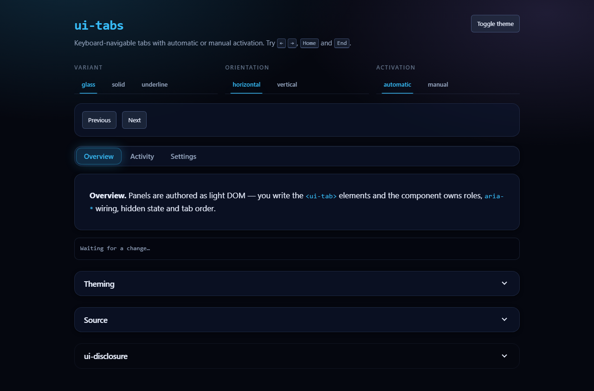

# UI4U

A framework-agnostic, mobile-first UI library for modern web apps.

Vanilla ES6 modules. Zero runtime dependencies. Custom elements throughout, so it drops
into any stack — or none. Every visual value is a `--ui4u-*` custom property, which makes
theming a token override rather than a CSS fork.

```
ui-tabs · 26.1 kB minified (~8.3 kB gzip) including tokens and themes
```

## Status

Early, and deliberately incremental. Shipped:

| Component | Demo | Notes |
| --- | --- | --- |
| `ui-tabs` | [`demo/tabs.html`](demo/tabs.html) | Keyboard nav, automatic + manual activation, 3 variants |
| `ui-disclosure` | [`demo/disclosure.html`](demo/disclosure.html) | Collapsible sections, real `<button>` trigger, `aria-expanded`, nesting |



Planned, in roadmap order: `ui-layout` (resizable top/left/right/middle/bottom) ·
`ui-sidebar` · `ui-grid` · `ui-input` · `ui-form` · `ui-popup` · `ui-tooltip` · `ui-button`.

## Install

```bash
npm install
```

## Use

### ES modules

```js
import 'ui4u';
```

```html
<ui-tabs label="Project sections">
  <ui-tab label="Overview">…</ui-tab>
  <ui-tab label="Activity">…</ui-tab>
  <ui-tab label="Settings">…</ui-tab>
</ui-tabs>

<ui-disclosure summary="Advanced">
  <p>Anything can go in here.</p>
</ui-disclosure>
```

### Script tag

```html
<link rel="stylesheet" href="/node_modules/ui4u/dist/ui4u.css" />
<script src="/node_modules/ui4u/dist/ui4u.global.js"></script>
```

### Individual components

Component modules have no import side effects, so you can register only what you use:

```js
import { Tabs, Tab, define, injectStyle } from 'ui4u';
import tabsCss from 'ui4u/src/components/tabs/tabs.css'; // bundler only

injectStyle('ui-tabs', tabsCss);
define('ui-tab', Tab);
define('ui-tabs', Tabs);
```

## API

Every component is a custom element configured through attributes and one options
object. Options are documented with JSDoc on the class; every public event is prefixed
`ui4u:`.

```js
const tabs = document.querySelector('ui-tabs');

tabs.configure({ variant: 'underline', activation: 'manual', active: 1 });

tabs.addEventListener('ui4u:change', ({ detail }) => {
  console.log(detail.index, detail.label);
});
```

## Theming

Themes are token overrides. Set `data-theme` on `<html>` to switch, or override any token
directly.

```html
<html data-theme="dark">
```

Built-in themes: `light`, `dark`, `contrast`, plus an automatic `prefers-color-scheme`
fallback when no `data-theme` is set.

```css
ui-tabs {
  --ui4u-primary: #f43f5e;
  --ui4u-radius-lg: 4px;
}
```

Motion honours `prefers-reduced-motion` — every `--ui4u-duration-*` token collapses to
`0ms` in one place, and components read those tokens rather than hardcoding timings.

## Development

```bash
npm install
npm run dev        # esbuild watch + demo server → http://localhost:5173
npm run build      # dist/: ESM, CJS, global build, minified ESM, combined CSS
npm run build:pages # static demo site in .pages/ for GitHub Pages
npm test           # node:test
npm run test:e2e   # Playwright (run `npx playwright install` once first)
npm run lint       # ESLint flat config
```

## Demo

The demo is published at **https://ai-agentcoder2026.github.io/UI4U/** — the `demo/` pages are served straight from `main` via the `Deploy demo to GitHub Pages` workflow, which runs lint and unit tests before every deploy.

Build outputs:

| File | For |
| --- | --- |
| `dist/ui4u.esm.js` | bundlers, `import` |
| `dist/ui4u.cjs` | Node `require` |
| `dist/ui4u.global.js` | `<script>` tags, exposes `window.UI4U` |
| `dist/ui4u.esm.min.js` | bundlers, minified |
| `dist/ui4u.css` | optional stylesheet instead of runtime injection |

## Contributing

Read [`AGENTS.md`](AGENTS.md) first — it defines the component contract, code style,
theming rules and testing expectations. A component is not done until it has a demo page
and tests.

## License

MIT