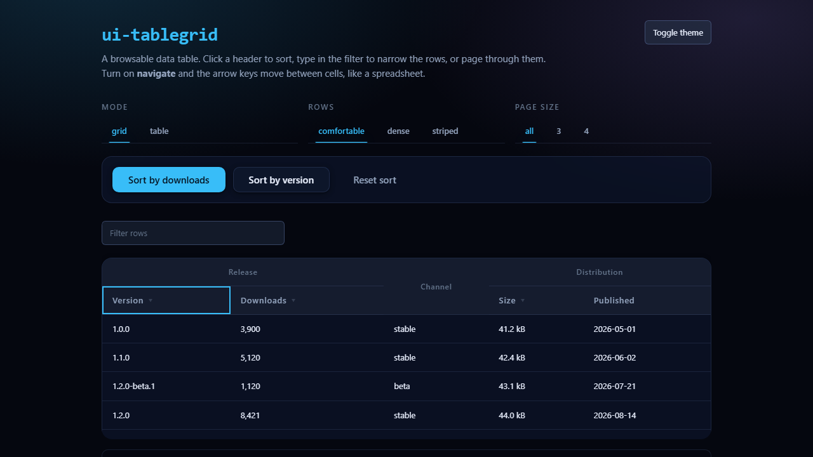

# UI4U

A framework-agnostic, mobile-first UI library for modern web apps.

Vanilla ES6 modules. Zero runtime dependencies. Custom elements throughout, so it drops
into any stack — or none. Every visual value is a `--ui4u-*` custom property, which makes
theming a token override rather than a CSS fork.

```
All ten components · 117.8 kB minified (~37.7 kB gzip) including tokens and themes
```

## Status

Early, and deliberately incremental. Shipped:

| Component         | Demo                                           | Notes                                                                     |
| ----------------- | ---------------------------------------------- | ------------------------------------------------------------------------- |
| `ui-tabs`         | [`demo/tabs.html`](demo/tabs.html)             | Keyboard nav, automatic + manual activation, 3 variants                   |
| `ui-disclosure`   | [`demo/disclosure.html`](demo/disclosure.html) | Collapsible sections, real `<button>` trigger, `aria-expanded`, nesting   |
| `ui-button`       | [`demo/button.html`](demo/button.html)         | 5 variants, 3 sizes, loading and disabled states                          |
| `ui-tooltip`      | [`demo/tooltip.html`](demo/tooltip.html)       | Hover + focus, viewport flipping, `Escape` to dismiss                     |
| `ui-layout`       | [`demo/layout.html`](demo/layout.html)         | All five regions resizable, recursive, keyboard + pointer splitters       |
| `ui-popup`        | [`demo/popup.html`](demo/popup.html)           | Modal with a real focus trap, plus popover and drawer modes               |
| `ui-input`        | [`demo/input.html`](demo/input.html)           | Native input preserved, plus `amount` (k/m/b) and `date` (picker) modes   |
| `ui-form`         | [`demo/form.html`](demo/form.html)             | Validation, inline errors, `role="alert"` error summary                   |
| `ui-sidebar`      | [`demo/sidebar.html`](demo/sidebar.html)       | Collapsible regions, off-canvas drawer on narrow screens                  |
| `ui-tablegrid`    | [`demo/tablegrid.html`](demo/tablegrid.html)   | Column groups, sorting, search, advanced filters, selection, copy, paging |
| `ui-checkbox`     | [`demo/checkbox.html`](demo/checkbox.html)     | Real `<input type="checkbox">`, `indeterminate`, shared validation        |
| `ui-radio`        | [`demo/radio.html`](demo/radio.html)           | Radio group with one tab stop and arrow-key movement                      |
| `ui-dropdown`     | [`demo/dropdown.html`](demo/dropdown.html)     | Listbox with type-ahead, arrow-key navigation and multi-select            |
| `ui-toolbar`      | [`demo/toolbar.html`](demo/toolbar.html)       | A bar of controls that is one tab stop; plugs into a layout or a grid     |
| `ui-button-group` | `demo/button-group.html`                       | Segmented control: buttons acting as one choice, one tab stop             |



Every component from the original roadmap has shipped. What to build next, and what the
audits found, is written up in [`docs/REVIEW.md`](docs/REVIEW.md).

## Install

```bash
npm install
```

## Use

### ES modules

```js
import 'ui4u';
```

```html
<ui-tabs label="Project sections">
  <ui-tab label="Overview">…</ui-tab>
  <ui-tab label="Activity">…</ui-tab>
  <ui-tab label="Settings">…</ui-tab>
</ui-tabs>

<ui-disclosure summary="Advanced">
  <p>Anything can go in here.</p>
</ui-disclosure>

<ui-button variant="primary" type="submit">Save</ui-button>
```

```html
<ui-layout>
  <ui-panel slot="top" label="Header" size="3.5rem" min="2rem" max="10rem" resizable>…</ui-panel>
  <ui-panel slot="left" size="16rem" min="10rem" resizable>…</ui-panel>
  <ui-panel slot="center">…</ui-panel>
  <ui-panel slot="bottom" label="Status" size="4rem" resizable>…</ui-panel>
</ui-layout>
```

Every region gets its own handle. Column separators (left / centre / right) are
`aria-orientation="vertical"` and respond to <kbd>←</kbd> <kbd>→</kbd>; row separators
(top / centre / bottom) are `aria-orientation="horizontal"` and respond to
<kbd>↑</kbd> <kbd>↓</kbd>. Both carry `aria-valuenow` plus `aria-valuemin`/`aria-valuemax`
when a bound is actually enforced. <kbd>Home</kbd>/<kbd>End</kbd> jump to the limits,
<kbd>Enter</kbd> collapses, double-click resets.

Layouts nest — any slot can hold another `ui-layout`, so a sidebar can be a
workspace of its own with its own centre, left/right and top/bottom:

```html
<ui-layout>
  <ui-layout slot="left" label="Explorer" size="260" min="180" resizable>
    <ui-panel slot="left" size="92" resizable>Rail</ui-panel>
    <ui-panel slot="center">Explorer body</ui-panel>
    <ui-panel slot="bottom" size="44">Filters</ui-panel>
  </ui-layout>

  <ui-panel slot="center">Editor</ui-panel>
  <ui-panel slot="bottom" size="4rem">Status</ui-panel>
</ui-layout>
```

Each nested layout keeps its own separators, sizes and keyboard step, and
`reset()` restores only that subtree. Events bubble, so `ui4u:resize` and
`ui4u:collapse` each carry the `layout` that emitted them:

```js
layout.addEventListener('ui4u:resize', (e) => {
  if (e.detail.layout !== layout) return; // a nested layout resized
});
```

### Script tag

```html
<link rel="stylesheet" href="/node_modules/ui4u/dist/ui4u.css" />
<script src="/node_modules/ui4u/dist/ui4u.global.js"></script>
```

### Individual components

Component modules have no import side effects, so you can register only what you use:

```js
import { Tabs, Tab, define, injectStyle } from 'ui4u';
import tabsCss from 'ui4u/src/components/tabs/tabs.css'; // bundler only

injectStyle('ui-tabs', tabsCss);
define('ui-tab', Tab);
define('ui-tabs', Tabs);
```

## API

Every component is a custom element configured through attributes and one options
object. Options are documented with JSDoc on the class; every public event is prefixed
`ui4u:`.

```js
const tabs = document.querySelector('ui-tabs');

tabs.configure({ variant: 'underline', activation: 'manual', active: 1 });

tabs.addEventListener('ui4u:change', ({ detail }) => {
  console.log(detail.index, detail.label);
});
```

## Theming

Themes are token overrides. Set `data-theme` on `<html>` to switch, or override any token
directly.

```html
<html data-theme="dark"></html>
```

Built-in themes: `light`, `dark`, `contrast`, plus an automatic `prefers-color-scheme`
fallback when no `data-theme` is set.

```css
ui-tabs {
  --ui4u-primary: #f43f5e;
  --ui4u-radius-lg: 4px;
}
```

Motion honours `prefers-reduced-motion` — every `--ui4u-duration-*` token collapses to
`0ms` in one place, and components read those tokens rather than hardcoding timings.

## Development

```bash
npm install
npm run dev        # esbuild watch + demo server → http://localhost:5173
npm run build      # dist/: ESM, CJS, global build, minified ESM, combined CSS
npm run build:pages # static demo site in .pages/ for GitHub Pages
npm test           # node:test
npm run test:e2e   # Playwright (run `npx playwright install` once first)
npm run lint       # ESLint flat config
```

## Demo

The demo is published at **https://ai-agentcoder2026.github.io/UI4U/** — the `demo/` pages are served straight from `main` via the `Deploy demo to GitHub Pages` workflow, which runs lint and unit tests before every deploy.

Build outputs:

| File                   | For                                              |
| ---------------------- | ------------------------------------------------ |
| `dist/ui4u.esm.js`     | bundlers, `import`                               |
| `dist/ui4u.cjs`        | Node `require`                                   |
| `dist/ui4u.global.js`  | `<script>` tags, exposes `window.UI4U`           |
| `dist/ui4u.esm.min.js` | bundlers, minified                               |
| `dist/ui4u.css`        | optional stylesheet instead of runtime injection |

## Contributing

Read [`AGENTS.md`](AGENTS.md) first — it defines the component contract, code style,
theming rules and testing expectations. A component is not done until it has a demo page
and tests.

## License

MIT
